# Portafolio de Evidencias

## Arquitectura de Computadoras

**Alumno:** Canche Ku Sair Geovanny  
**Semestre y grupo:** 5° B  
**Materia:** Arquitectura de Computadoras  
**Docente:** Gabriel Ubaldo González Cauich  
**Unidad:** 1 y 2
**Actividad:** Portafolio de Evidencias  
**Período:** 2026-B  

**Motul, Yucatán, México; 20 de Octubre de 2026**

---

# Introducción

Este portafolio de evidencias, basado en el primer parcial de la asignatura Arquitectura de Computadoras, recopila todas las actividades realizadas durante el mismo. Este primer parcial sirvió como introducción y base para los futuros parciales al tocar temas fundamentales, tales como definir qué es la arquitectura de computadoras, la organización, familias de computadoras, generaciones de computadoras, jerarquía de buses, jerarquía de memorias, entre otros.

Durante este parcial se elaboraron diferentes actividades, como primera actividad se realizo prueba diagnóstica, la cual sirvió para comprobar los conocimientos previamente adquiridos y relacionados con la materia a tratar; posteriormente, se hicieron dos programas para una computadora del año 1952 llamada IAS y, como complemento a estos, se contestó una pregunta para complementar la actividad; también se realizó un esquema para expandir mis conocimientos sobre los distintos tipos de arquitecturas de computadoras y, por último, se realizó un proyecto con el integrado 6116, el cual es una RAM, para ver cómo se almacenan los datos en ella y el flujo de los mismos.

---

# Objetivo del portafolio

El objetivo de este portafolio es recopilar las actividades realizadas durante el primer parcial de forma ordenada y organizada, con el fin de poner en perspectiva la comprensión de temas nuevos y relevantes que fueron tratados, el alcance obtenido a lo largo de las sesiones y el reconocimiento de sectores donde necesito mejorar.

---

# Índice

## Unidad 1

  - 1. [Prueba diagnóstica](#1-prueba-diagnóstica)
  - 2. [Programación de la IAS](#2-programación-de-la-ias)
  - 3. [Mapa conceptual de modelos de arquitectura de cómputo](#3-mapa-conceptual-de-modelos-de-arquitectura-de-cómputo)
  - 4. [Práctica de memoria RAM 6116](#4-práctica-de-memoria-ram-6116)
  - 5. [Reflexión general de la unidad 1](#reflexión-general-de-la-unidad-1)
  - 6. [Conclusión unidad 1](#conclusión-unidad-1)
   
## Unidad 2

  - 1. [Rubrica del portafolio de la unidad 1](#1-rubrica-del-portafolio-de-la-unidad-1)
  - 2. [Ejercicios de clase](#2-ejercicios-de-clase)
  - 3. [Questions and problems](#3-questions-and-problems)
  - 4. [Ejercicios de clase 2](#4-ejercicios-de-clase-2)
  - 5. [Presentación por equipos del segundo tipo de direccionamiento](#5-presentación-por-equipos-del-segundo-tipo-de-direccionamiento)
  - 6. [Questions and problems 2](#6-questions-and-problems-2)
  - 7. [Reflexión general de la unidad 2](#reflexión-general-de-la-unidad-2)
  - 8. [Conclusión unidad 2](#conclusión-unidad-2)

---

# Unidad 1

---

# 1. Prueba diagnóstica

## Descripción de la actividad

La primera actividad que se realizó en el parcial fue una prueba diagnóstica por medio de un Forms; esta tuvo como objetivo comprobar los conocimientos que tenía sobre el tema de arquitectura de computadoras. En esta vinieron varios temas interesantes sobre este ámbito, entre estos la identificación de diferentes registros con distintas cantidades de bits, las generaciones de computadoras, microprocesadores con diferentes tecnologías y las leyes de Dennard, Moore y Amdahl, las cuales son de suma importancia en este ámbito. Posteriormente a contestar todas las preguntas, no obtuve una calificación aprobatoria, por lo que tuve que copiar todas las preguntas con sus respuestas correctas y responder nuevamente el Forms hasta obtener una calificación aprobatoria. Después de eso, el maestro procedió a sellar el cuestionario que copié en mi libreta y subí la evidencia en un apartado del Classroom de la materia.

## Evidencia

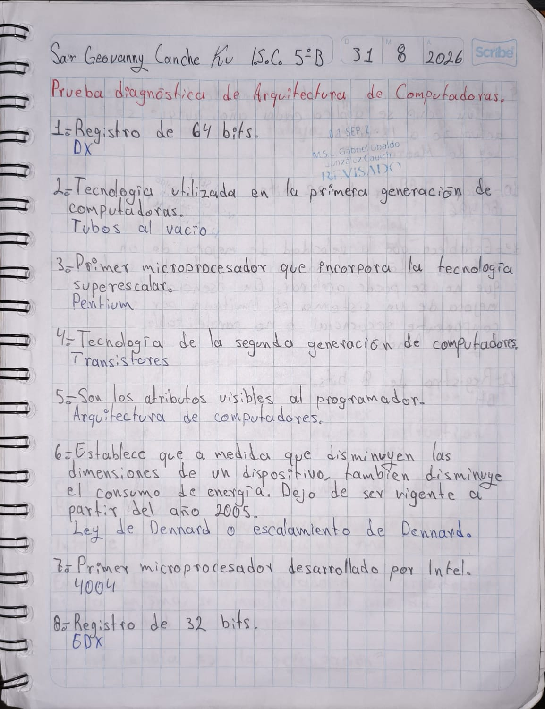
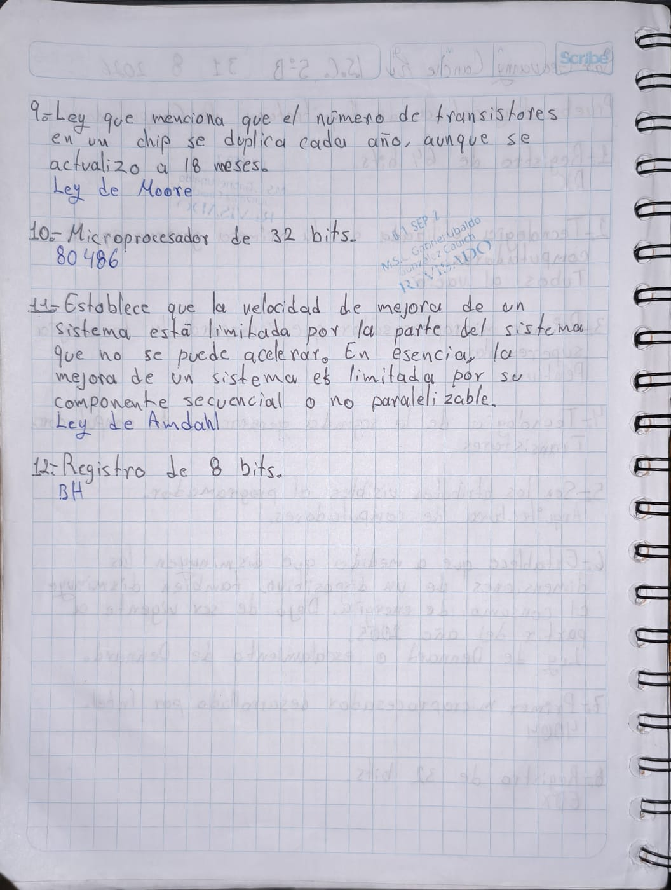

## ¿Qué aprendí?

Con esta prueba diagnóstica pude identificar el conocimiento que poseía sobre los temas tratados en la misma, y aunque sí tenía noción de las respuestas de algunas de las preguntas, la mayoría fueron las que desconocía, lo que me hizo reconocer que necesitaba expandir mis conocimientos sobre estos temas. De igual manera, pude aprender que existen distintos tipos de registros, los cuales varían en su tamaño de bits, y de igual manera conocí que existen diferentes leyes que dictaminan aspectos importantes sobre la arquitectura de computadoras, también que estas podían cambiar o incluso dejar de ser vigentes.

## Errores y aspectos por mejorar

Esta prueba diagnóstica puso en evidencia que, a pesar de tener algunos conocimientos básicos, lo que predominaba era el poco dominio y conocimiento acerca de los temas tratados al contestar la mayoría de las preguntas de manera errónea. Esto me hizo darme cuenta de que necesito indagar más sobre la arquitectura de computadoras y todo lo que está relacionado con ella.

---

# 2. Programación de la IAS

## Descripción de la actividad

En esta práctica desarrollé dos programas con la sintaxis de la computadora IAS del año 1952, cuya arquitectura binaria y de programa almacenado emplea instrucciones de 20 bits, 8 bits para el código de operación y 12 para la dirección de memoria. Para su elaboración, me apoyé en la tabla de instrucciones provista por el profesor.

El primer programa sumó dos números ubicados en las direcciones 0 y 1, guardando el resultado en la dirección 2. El proceso consistió en cargar el dato de la ubicación 0 al acumulador, sumarle el valor de la ubicación 1 y almacenar el resultado final en la ubicación 2.

El segundo programa identificó el mayor entre los datos de las ubicaciones 0 y 1 para guardarlo en la dirección 2. Al no existir una instrucción directa de comparación, apliqué una resta: si el resultado era negativo, el número de la dirección 1 era el mayor; de lo contrario, lo era el de la dirección 0. Tras confirmar que la resta no sobrescribía los valores originales de la memoria, cargué el dato de la dirección 0 al acumulador y le resté el de la dirección 1. Luego utilicé la instrucción JUMP condicional (salto si el acumulador es no negativo): si el resultado era no negativo, saltaba a las instrucciones que cargaban la ubicación 0 en el acumulador y la guardaban en la ubicación 2; si era negativo, continuaba a la siguiente línea cargando el valor de la ubicación 1 en el acumulador para luego almacenarlo en la ubicación 2.

Finalmente, respondí la pregunta sobre el uso de los 12 bits de dirección: expliqué que completaban el formato de instrucción de 20 bits (junto a los 8 bits de operación) y permitían direccionar un máximo de 4096 palabras en memoria.

## Evidencias

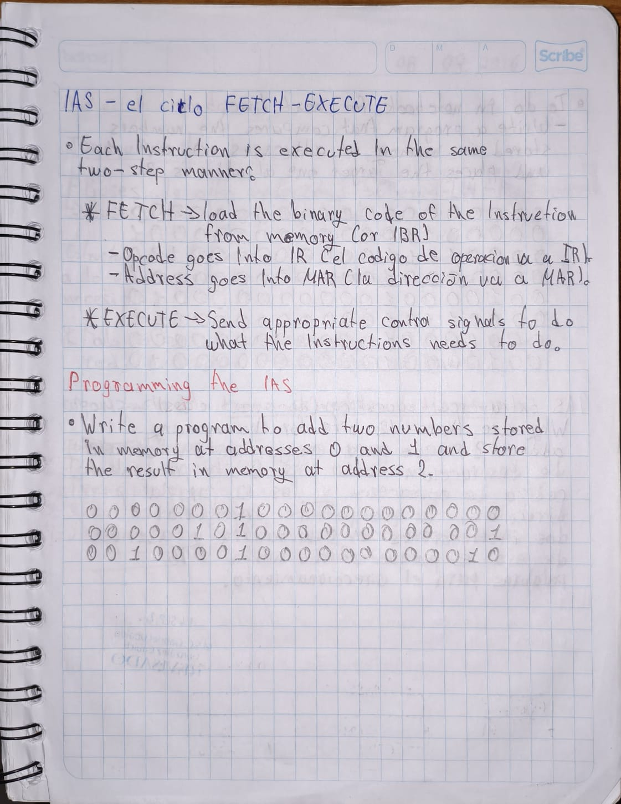

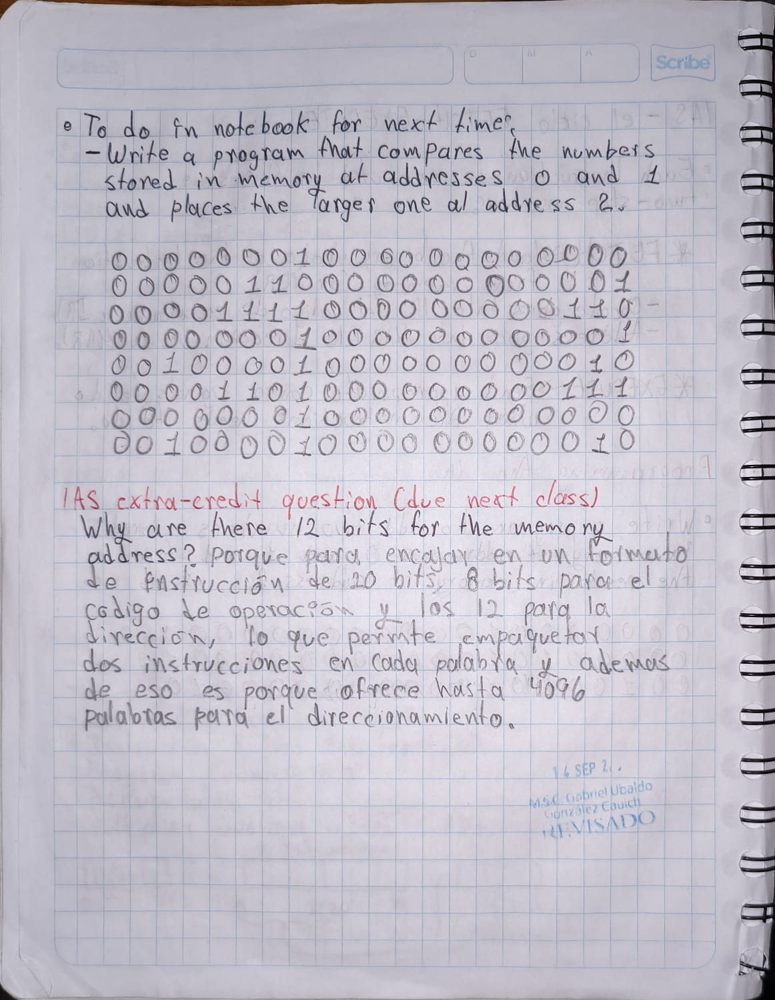

## ¿Qué aprendí?

En esta actividad pude adquirir varios conocimientos nuevos; aprendí a cómo hacer programas utilizando las instrucciones propias de la computadora IAS, como el traslado de un valor numérico de una dirección de memoria al acumulador, la suma, la resta, el guardado de un dato del acumulador a una nueva dirección de memoria y la instrucción JUMP. También pude aprender que, para realizar una operación sin tener una instrucción directa de lo que se quiere hacer, se puede recurrir a otros métodos para llegar al mismo resultado. Otra cosa que me llevé como enseñanza fue el comprender de mejor manera cómo se van moviendo los datos por medio del sistema binario.

## Errores y aspectos por mejorar

En donde presenté más errores fue en el segundo código ya que primero, al no saber que, al no ser sobrescritos, los datos aún se conservan, lo cual me indica que tengo que aprender y analizar a fondo el funcionamiento, la sintaxis y las características de alguna tecnología desconocida con la que vaya a trabajar, para así hacer un trabajo mejor y de manera más óptima. Otro aspecto que identifiqué a mejorar es mi análisis lógico para la resolución de problemas, ya que, aunque pude realizar lo que se me indicaba realizar, sí me llevó más tiempo del que hubiera deseado encontrar una solución.

---

# 3. Mapa conceptual de modelos de arquitectura de cómputo

## Descripción de la actividad

En esta actividad realicé un mapa conceptual sobre las arquitecturas de computadoras de John Von Neumann o arquitectura clásica, arquitectura segmentada y arquitectura multiproceso. Durante la elaboración de este, tuve que realizar una amplia investigación por medio de diferentes fuentes de información para poder encontrar en qué se enfocaba cada una, sus características, limitaciones, riesgos, etapas, componentes, etc., para después seleccionar lo más relevante y organizarlo de manera jerárquica y visual.

## Evidencia

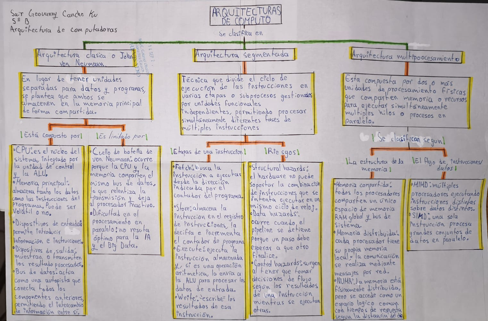
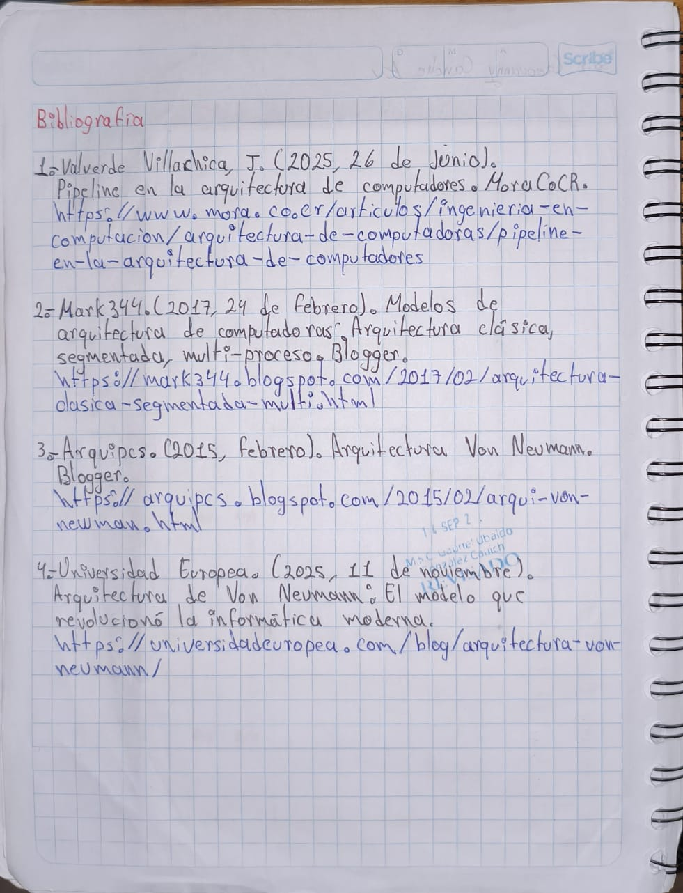
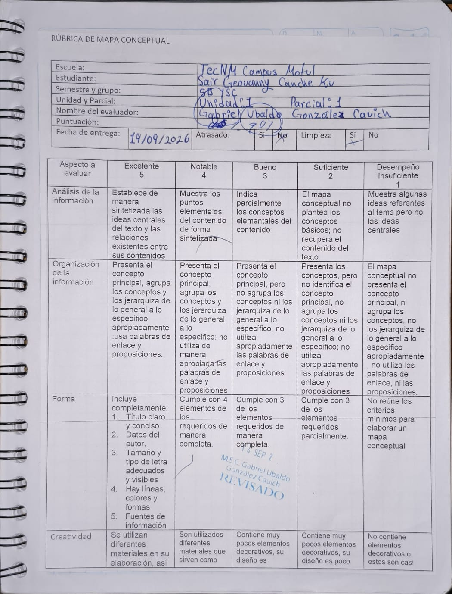
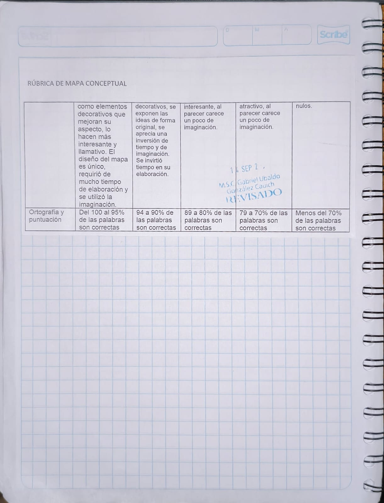

## ¿Qué aprendí?

La elaboración de este mapa conceptual me ayudó a ampliar mis conocimientos sobre las distintas arquitecturas de computadoras. Durante el proceso de investigación pude informarme más a fondo de cada una de ellas y después, al elaborar el mapa, pude concentrar la información más relevante y organizarla de manera jerárquica. Aprendí el concepto fundamental de cada una de ellas y cómo identificarlas; de igual manera, comprendí cuáles eran sus elementos y el funcionamiento de estos, sus limitaciones, riesgos, estructuras y flujos de datos. De igual manera, me ayudó a unir ideas que antes de esta actividad tenía como conceptos sueltos.

## Errores y aspectos por mejorar

Uno de los aspectos a mejorar es mi organización jerárquica, ya que con la información recopilada pude haber derivado a más niveles, lo que haría la lectura del mapa conceptual más ligera. También pude haber sintetizado la información de una mejor manera para reducir el texto y solo tener las ideas relevantes; al igual debería mejorar en mi utilización de palabras clave y conectores. Por último, en el apartado visual, pude haberlo hecho más vistoso a la vista, lo que haría que llame más la atención del lector.

---

# 4. Práctica de memoria RAM 6116

## Descripción de la actividad

Esta fue la actividad final del parcial y, a mi parecer, también fue la más interesante. Esta actividad se realizó en equipo, lo que hicimos fue construir un circuito utilizando el integrado 6116, el cual es una memoria RAM, en conjunto con el integrado 74245, el 7448 y un display de cátodo común. Recreamos el circuito en un protoboard con base en una imagen que nos proporcionó el maestro, pero al momento de probar el circuito que se veía visualmente idéntico al del maestro, ni siquiera encendía el display.

Así que desmontamos todo del protoboard y, con ayuda de la imagen antes mencionada, se vio la estructura básica del circuito; pero en esta ocasión, en vez de armarlo con eso como única referencia, utilizamos las datasheets de cada uno de los integrados, analizando el porqué de cada conexión y la utilidad de cada pin. Optamos por crear un diagrama partiendo del análisis individual de cada integrado para facilitar el trabajo de ensamblado del circuito.

El primer integrado al cual se le aplicó el análisis fue el 6116, del cual aterrizamos las direcciones que no íbamos a ocupar porque en esta práctica solo utilizamos 4 de ellas, las cuales van conectadas a cada uno de los pines de un dip switch. De igual manera, solo utilizamos 4 de los pines I/O del integrado, por lo cual los demás se aterrizaron. Alimentamos el pin 24 y aterrizamos el 12; también se aterrizó el pin CS para que el integrado siempre esté activo, y a los pines WE y OE se les creó una conexión con un botón a cada uno. Con eso ya estaba prácticamente listo el análisis del 6116.

Seguidamente pasamos al análisis del 74245, el cual era un bus bidireccional, se conectó su pata 20 a la alimentación y la 10 a tierra, también la 1 para que los datos viajaran de B hacia A y el pin 19 a un dip switch para controlar el flujo de los datos. Del lado B de este estaban conectados 4 de sus pines a un dip switch, de donde se cargaba el dato binario a guardar, y hacia el lado A, que es por donde se conectaba al 6116, se dirigía el dato.

Seguidamente se analizó el 7448, cuyo trabajo era decodificar la señal de 4 bits para el display. Después de analizar todo eso y tener el diagrama completo, procedimos a montar todo de nuevo en el protoboard; probamos y funcionó sin problemas.

## Evidencias

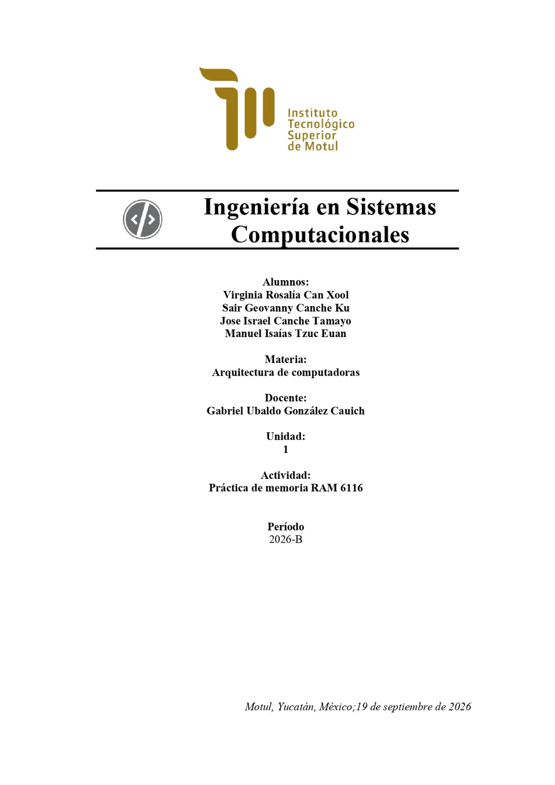
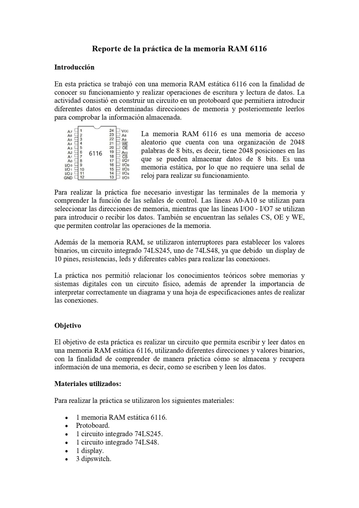
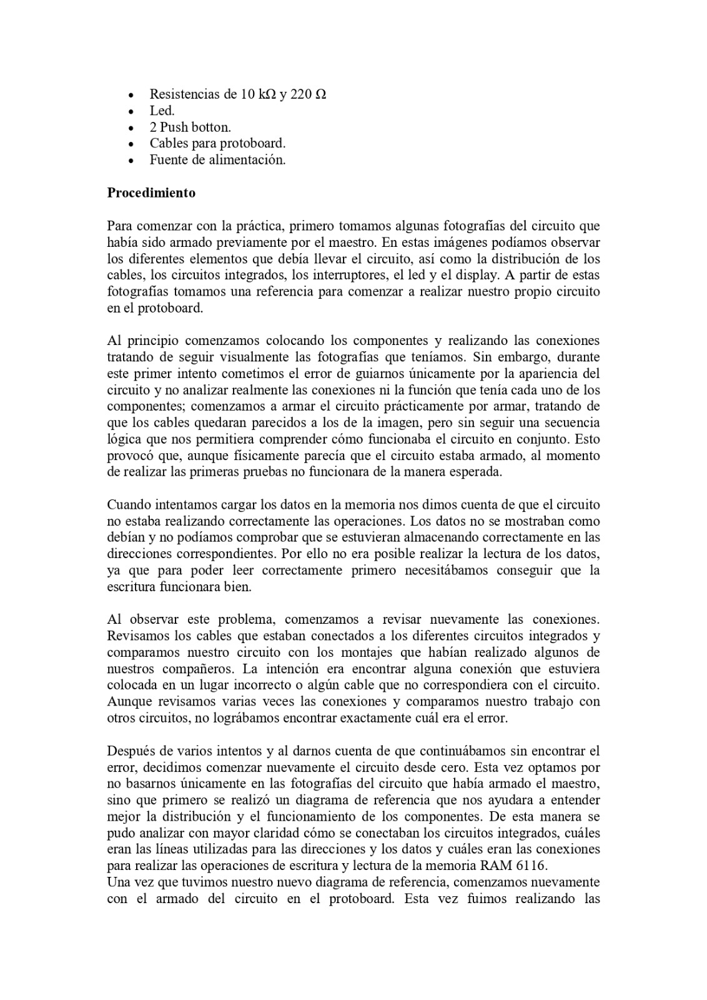
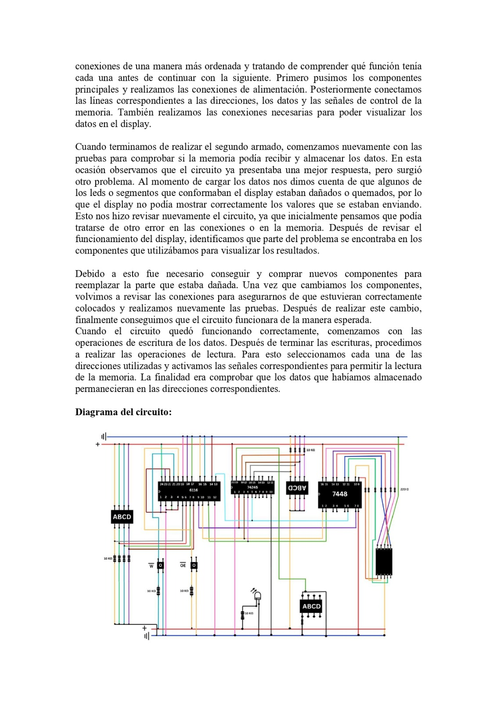
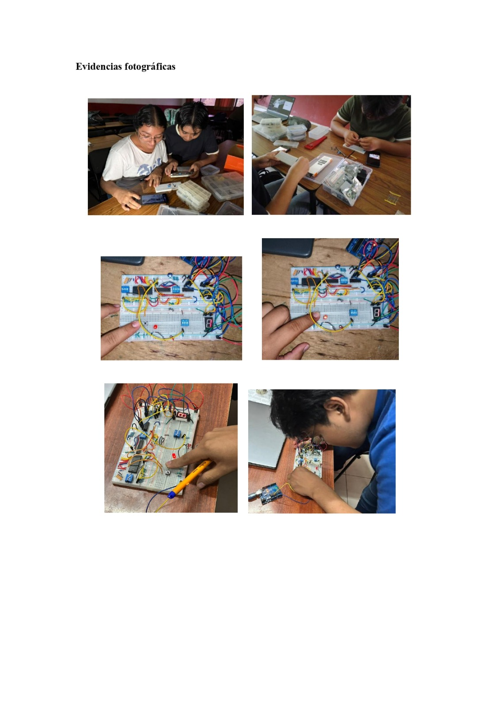
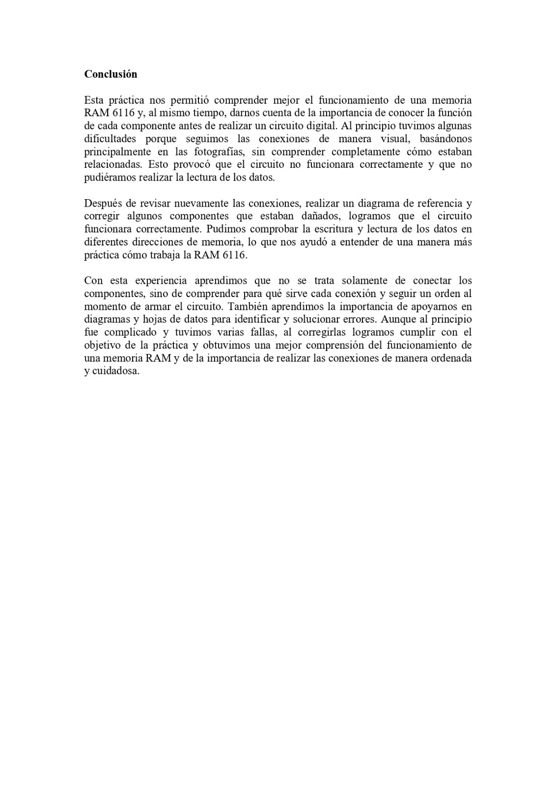
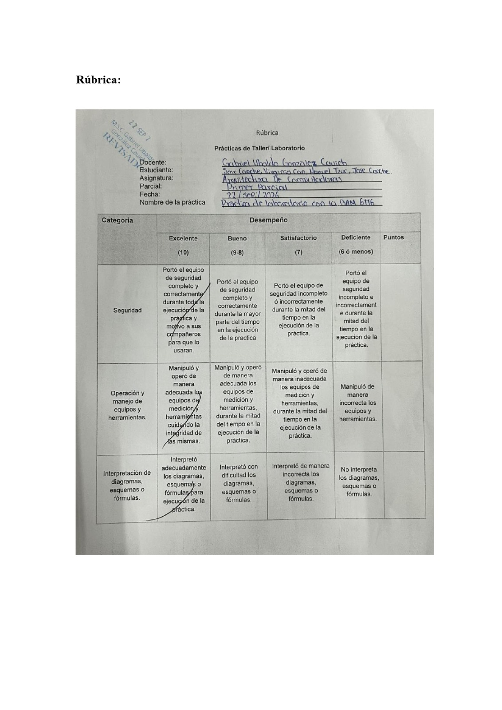
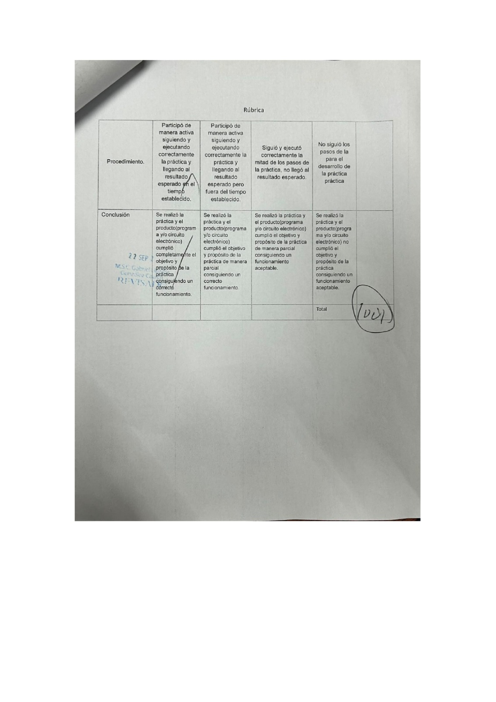

## ¿Qué aprendí?

En esta práctica aprendí varias cosas las cuales pienso que me serán útiles, ya que pude comprender temas como el cómo utilizar una memoria RAM y el proceso para guardar un dato en una de sus tantas direcciones de almacenamiento, la relevancia de los bits en las memorias, ya que derivado de eso comprendí temas de los que sí tenía una noción de qué trataban, pero no de la manera en que lo hago ahora, por ejemplo, los B, KB, MB, GB, etc. Aprendí cómo realizar el análisis de circuitos e integrados por mi propia cuenta al contar solo con herramientas como el datasheet; de igual manera, aprendí a utilizar nuevos materiales como el 6116, el 74245, el 7448 y el display, aprendiendo la funcionalidad de todos sus pines gracias al análisis hecho previamente.

## Errores y aspectos por mejorar

El principal error que se cometió en esta práctica fue no tomarnos el tiempo para analizar el circuito de manera profunda, examinando cada uno de sus integrados de manera individual, revisar el porqué de las conexiones y el no comenzar por realizar el diagrama, el cual nos hubiera ahorrado tiempo y facilitado el proceso desde el principio.

---

# Reflexión general de la unidad 1

La unidad fue muy interesante al poder ampliar conocimientos previos y relacionarlos entre sí; de igual manera, pude conocer temas nuevos los cuales son muy interesantes y útiles. Pude aprender las diferentes arquitecturas de computadoras, sus características, ventajas y desventajas. De igual manera, pude ver la evolución de las distintas tecnologías por las que han pasado los equipos de cómputo, desde los tubos al vacío hasta los microprocesadores y memorias semiconductoras. Comprendí los diferentes tipos de memorias, el porqué unas son más caras, veloces o con mayor almacenamiento, la diferencia entre arquitectura u organización, sobre los buses y demás temas de suma importancia. En general, pienso que la unidad fue muy interesante y me será muy útil al haber aprendido conceptos básicos los cuales me servirán en temas futuros.

---

# Conclusión unidad 1

En conclusión, considero que esta unidad ha estado llena de aprendizajes nuevos e importantes, como por ejemplo las arquitecturas de computadoras, la evolución de los equipos de cómputo y la utilización de nuevos integrados; pero de igual manera me sirvió para refrescar temas vistos antes, como los números binarios y el armado de circuitos electrónicos en protoboard. Considero que todos los aprendizajes adquiridos en la unidad me serán de gran utilidad en el ámbito profesional, al poder entender de mejor manera los equipos de cómputo.

---

# Unidad 2

---

# Introducción

Este portafolio de evidencias, basado en la segunda unidad de la asignatura Arquitectura de Computadoras, recopila todas las actividades realizadas durante la misma. Esta segunda unidad permitió profundizar en el funcionamiento interno del microprocesador y en la manera en que este trabaja con los registros y la memoria. Entre los temas principales se encuentran la arquitectura interna del microprocesador, el modelo de programación, los registros de propósito general y de propósito especial, el registro de banderas, los registros de segmento y las diferentes formas de direccionamiento de memoria.

Durante esta unidad se realizaron diferentes actividades enfocadas en comprender el funcionamiento del microprocesador y el manejo de la memoria. Se estudiaron los distintos registros del microprocesador y la función que cumple cada uno, así como el registro de banderas y el significado de sus diferentes bits. También se trabajó con el direccionamiento de memoria en modo real, donde las direcciones se forman mediante un segmento y un desplazamiento.

En conjunto, las actividades realizadas durante esta unidad permitieron ampliar los conocimientos sobre la arquitectura del microprocesador y comprender de una manera más práctica cómo se procesan los datos y cómo se accede a las diferentes ubicaciones de memoria.

---

# Objetivo del portafolio

El objetivo de este portafolio es recopilar las actividades realizadas durante la segunda unidad de forma ordenada y organizada, con el fin de poner en perspectiva la comprensión de los temas nuevos y relevantes relacionados con el funcionamiento interno del microprocesador, los registros, el direccionamiento de memoria y los diferentes modelos de memoria estudiados durante la unidad. Asimismo, busca reflejar el alcance obtenido a lo largo de las sesiones y permitir el reconocimiento de aquellos aspectos en los que es necesario seguir mejorando.

---

# 1. Rubrica del portafolio de la unidad 1

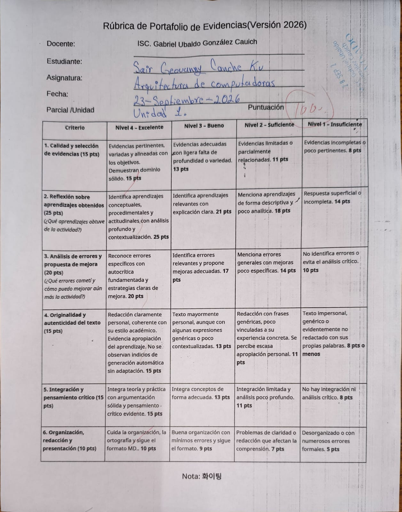

---

# 2. Ejercicios de clase

## Descripción de la actividad

Como primera actividad del parcial, se realizó este bloque de ejercicios durante la clase con ayuda del profesor. Previamente, tuvimos una introducción al tema, la cual consistió en la explicación del método "segmento más desplazamiento", el cual fue el utilizado para resolver el bloque de ejercicios, donde se usó una dirección inicial para poder acceder a la dirección final del segmento.

## Evidencia

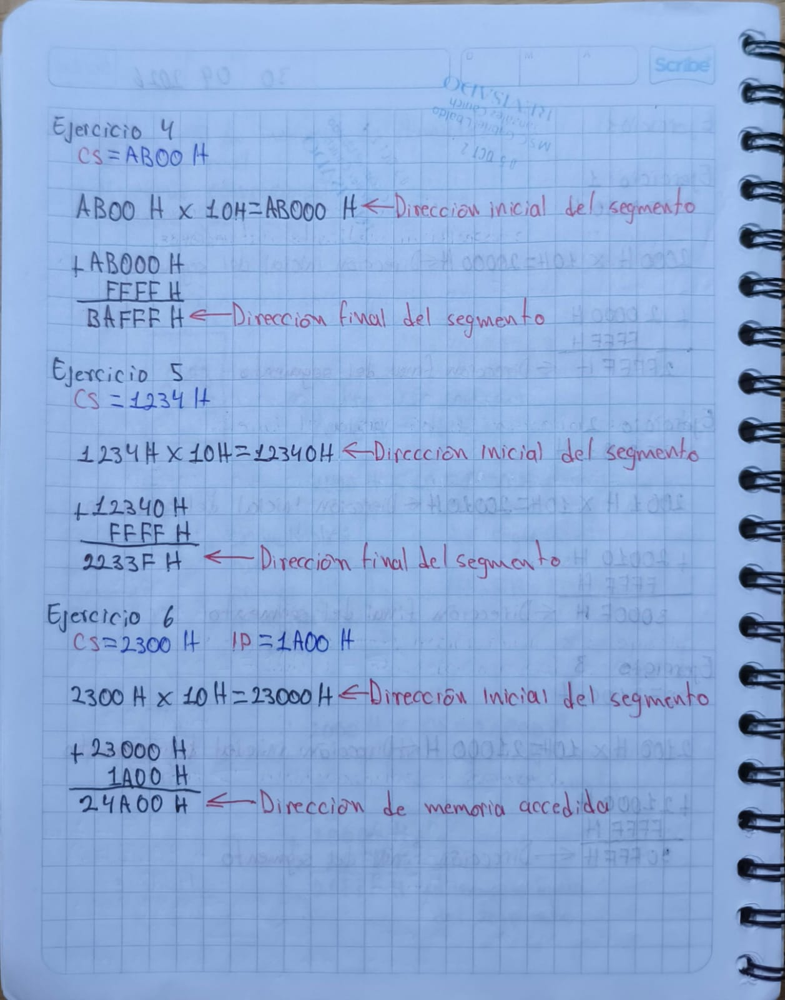

## ¿Qué aprendí?

Con esta primera actividad, logré entender el método "segmento más desplazamiento" para poder acceder a una dirección final de segmento. Para ello, tuve que recordar temas vistos en semestres anteriores, como lo son los números hexadecimales y la suma de los mismos; de igual manera, tuve que aplicar nuevos conocimientos, como lo sería utilizar el registro CS para poder calcular la dirección inicial de memoria y, después de eso, sumarle FFFFH para calcular la dirección final del segmento.

## Errores y aspectos por mejorar

Con esta actividad pude darme cuenta de que necesitaba recordar y fortalecer mis conocimientos acerca de los números hexadecimales y sus operaciones, ya que estos son muy importantes para realizar el cálculo de las direcciones de segmentos.

---

# 3. Questions and problems

## Descripción de la actividad

Para esta segunda actividad, el profesor proporcionó un bloque de preguntas y ejercicios en conjunto con un libro para poder profundizar en la arquitectura del microprocesador, el cual tendríamos que consultar para realizar las actividades proporcionadas. Tanto las preguntas como los ejercicios estuvieron relacionados con los registros del microprocesador, en los cuales se profundizó sobre sus características y la manera en la que se utilizan. Con respecto a los ejercicios en donde se utilizó "segmento más desplazamiento", algunos fueron iguales a los hechos previamente, ya que el objetivo era calcular la dirección final del segmento; pero otros buscaban acceder a diferentes direcciones de memoria, por lo que, además del registro CS, se utilizaron otros registros.

## Evidencias

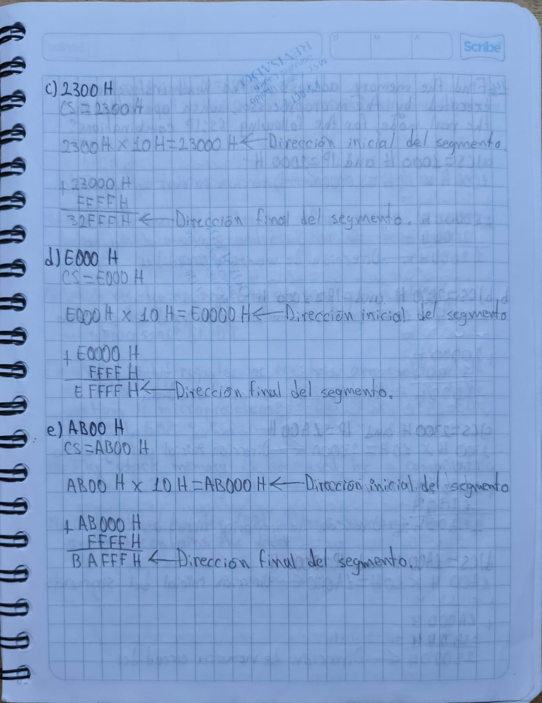

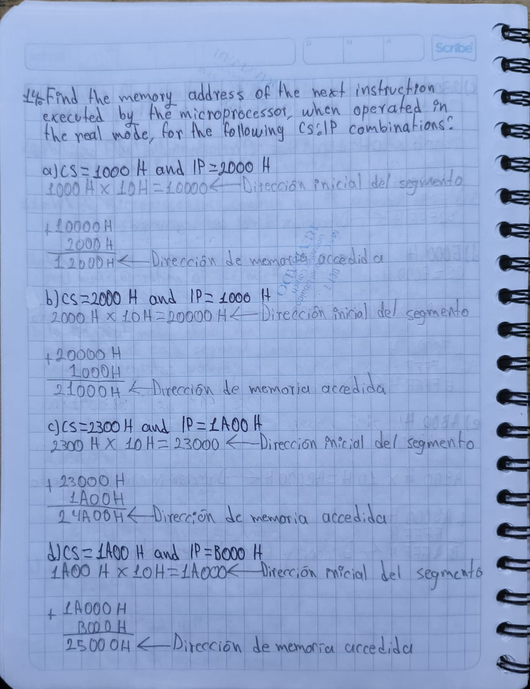

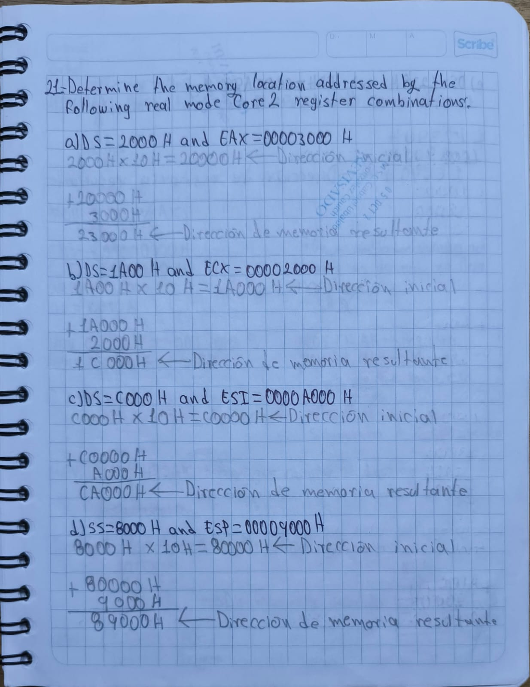

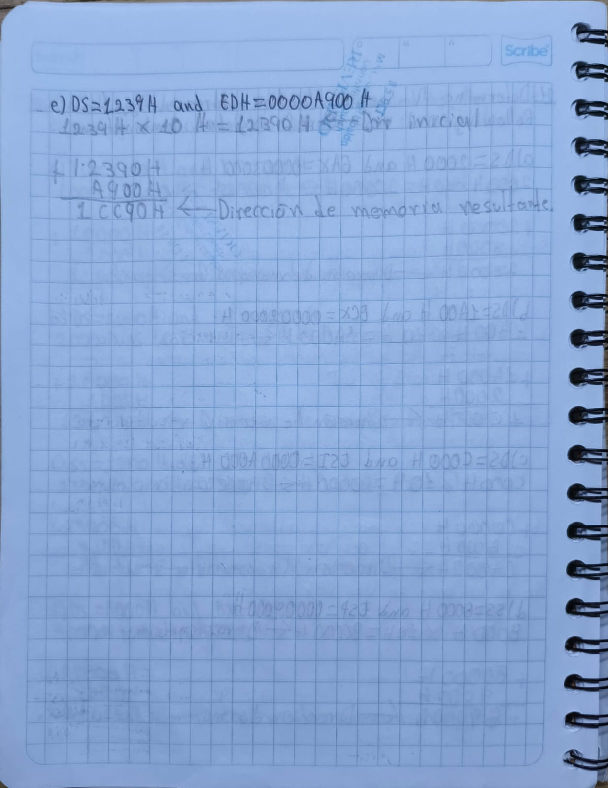

## ¿Qué aprendí?

Durante la realización de esta actividad, pude comprender de mejor manera la arquitectura interna del microprocesador, sus registros y los diferentes tamaños de estos, ya sean de 8, 16, 32 o 64 bits, y para qué sirve cada uno. Por último, aprendí a utilizar el método "segmento más desplazamiento" no solo para calcular la dirección final de un segmento, sino también para calcular una dirección de memoria en colaboración con otros registros además del CS.

## Errores y aspectos por mejorar

En primer lugar, necesito estudiar más a fondo cada uno de los registros, ya que, al ser una cantidad considerable, aún tengo problemas para identificarlos, recordar su funcionalidad y su tamaño. Por último, necesito aumentar mi dominio con los números hexadecimales, ya que soy capaz de realizar los ejercicios, pero podría hacerlos de manera más eficiente.

---

# 4. Ejercicios de clase 2

## Descripción de la actividad

Esta actividad se realizó durante la clase con ayuda del maestro, la cual consistió en realizar un bloque de ejercicios relacionados con un nuevo tema, el cual fue "modos de direccionamiento de datos". En este se vieron los distintos tipos de modos de direccionamiento de datos en conjunto con las operaciones necesarias para realizarlos y las distinciones que hay entre estas. En este se utilizó la instrucción "MOV", la cual le indica al procesador que se va a hacer una transferencia de datos, ya sea a un registro o a una dirección de memoria; este, de igual modo, ocupa el método de "segmento más desplazamiento", ya sea para calcular el origen o el destino del dato.

## Evidencia

## ¿Qué aprendí?

Aprendí a utilizar los modos de direccionamiento de memoria para transferir datos entre registros y direcciones de memoria, así como a diferenciar los distintos tipos que existen, entre estos están el inmediato, directo, registro indirecto, etc. De igual manera, aprendí que mediante la instrucción MOV se le indica al microprocesador la ejecución de una transferencia de datos empleando un direccionamiento específico. Por último, comprendí las restricciones que esto implica, como la regla sobre la compatibilidad de tamaño entre el destino y el origen.

## Errores y aspectos por mejorar

Uno de los aspectos en los que necesito mejorar es la identificación de los distintos tipos de direccionamiento de memoria, ya que, aunque algunos son sencillos de reconocer, otros poseen estructuras muy similares entre sí que pueden llevar a confusiones. Asimismo, debo memorizar las restricciones de este método para evitar cometer errores en las operaciones.

---

# 5. Presentación por equipos del segundo tipo de direccionamiento  

## Descripción de la actividad

Para profundizar en los modos de direccionamiento de datos, realizamos una exposición en equipo sobre cada uno de ellos. A mi equipo y a mí nos correspondió el segundo tipo: el direccionamiento inmediato. Con este fin, consultamos el capítulo 3 proporcionado por el profesor, lo que nos permitió comprender a fondo su funcionamiento y componentes.

## Evidencias

## ¿Qué aprendí?

Durante la elaboración de esta presentación, comprendí mejor el modo de direccionamiento directo y su funcionamiento, el cual no requiere cálculos para hallar la dirección de memoria del dato. Asimismo, entendí la relación entre el tamaño en bits de los valores hexadecimales y la posibilidad de almacenarlos en un registro según la capacidad de este.

## Errores y aspectos por mejorar

Más allá de identificar un aspecto técnico por mejorar sobre este tema, la actividad me dejó claro que debo fortalecer mis habilidades de expresión oral. Aunque logré transmitir la información, soy consciente de que puedo hacer exposiciones de forma más fluida y efectiva.

---

# 6. Questions and problems 2

## Descripción de la actividad

Como última actividad del segundo parcial, realizamos un segundo bloque de ejercicios enfocado en los modos de direccionamiento de datos, contando nuevamente con el material proporcionado por el profesor. La actividad requirió describir el funcionamiento de ciertas operaciones, enumerar registros según su capacidad, detectar errores en operaciones específicas y emplear la instrucción MOV para transferencias. Además, se resolvieron problemas de transferencia de datos en los que se debía calcular la dirección inicial o accedida; estos ejercicios resultaron más complejos que los anteriores, ya que requerían de la realización múltiples sumas o algunas incluso requerían multiplicaciones adicionales.

## Evidencias

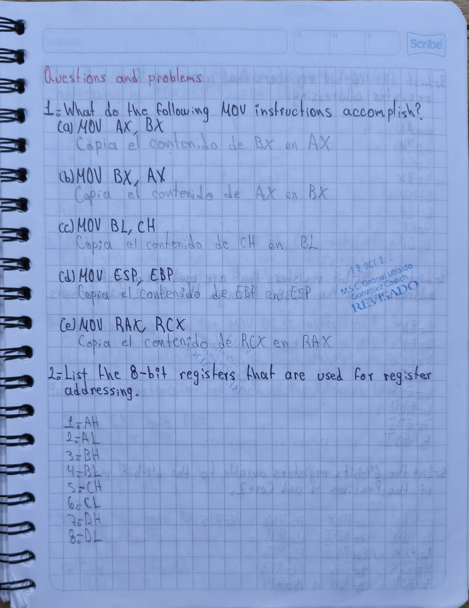

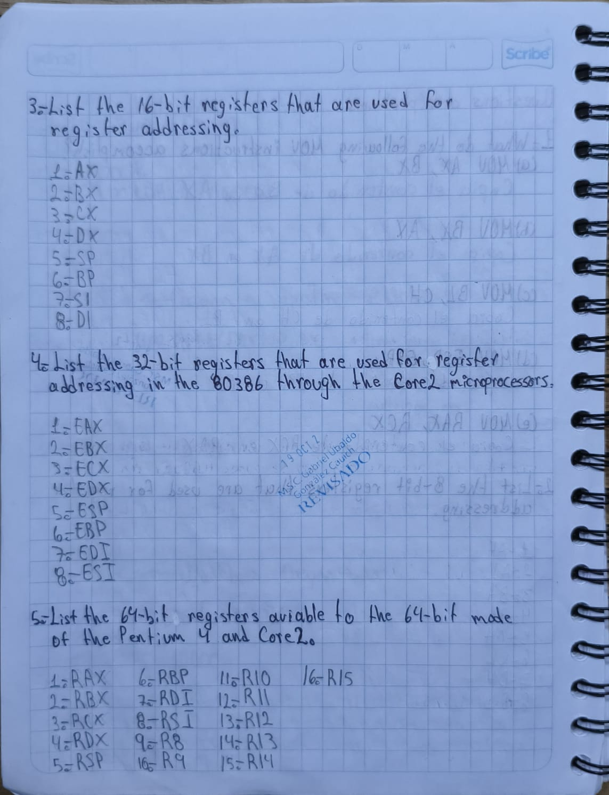

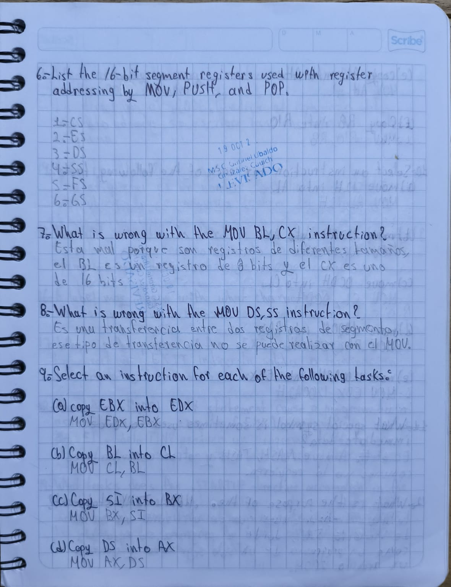

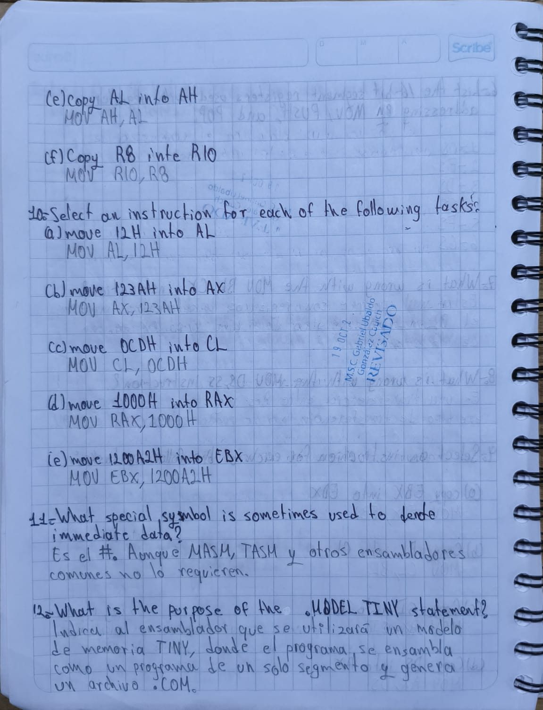

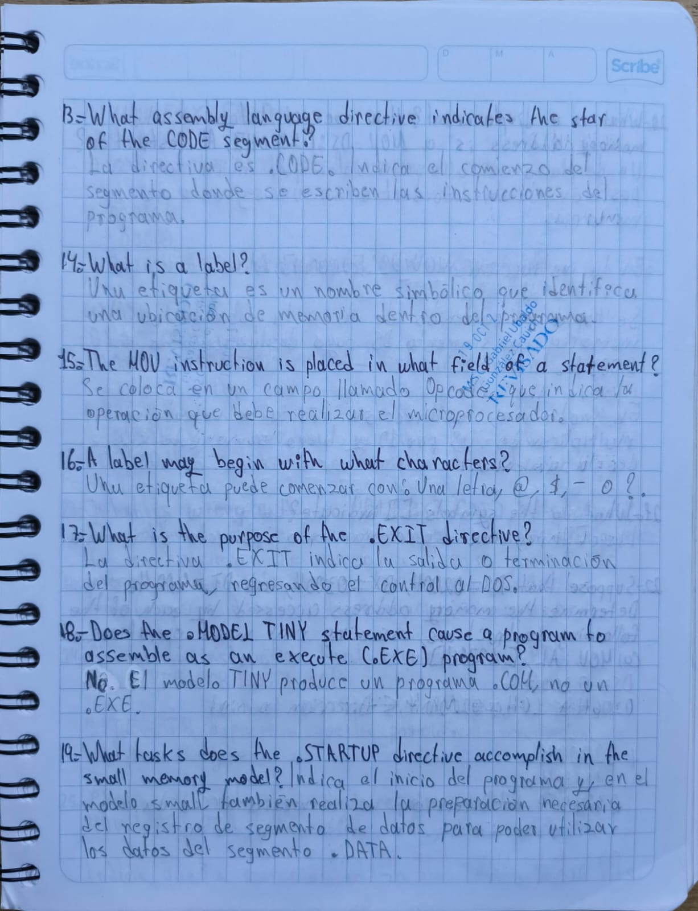

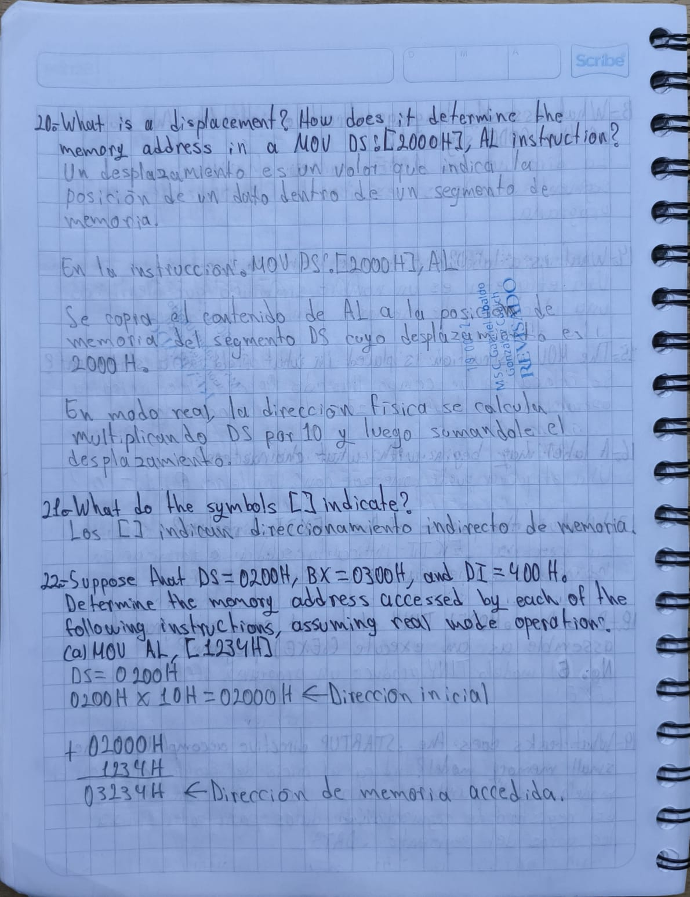

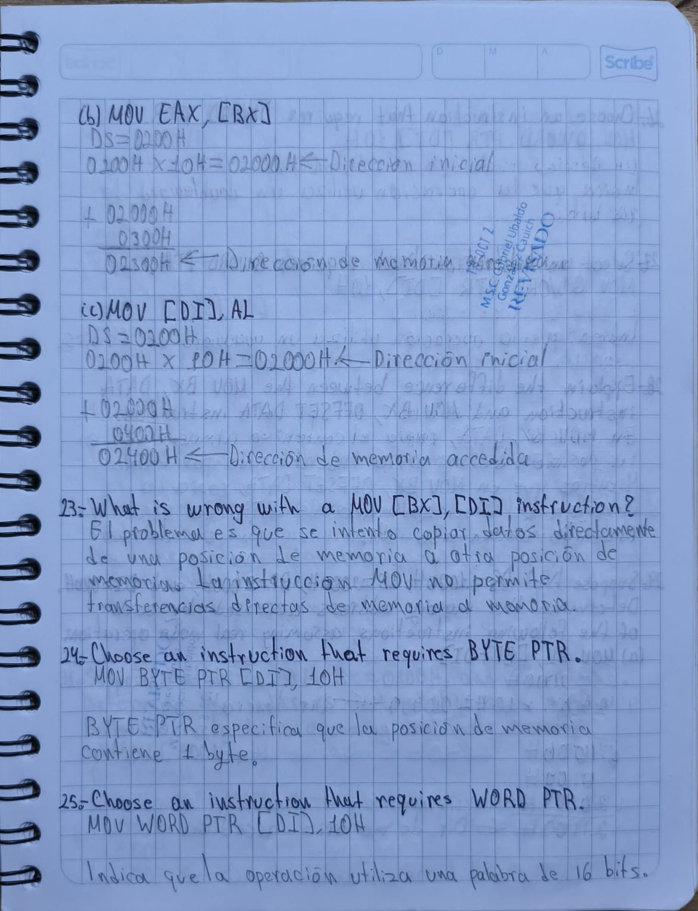

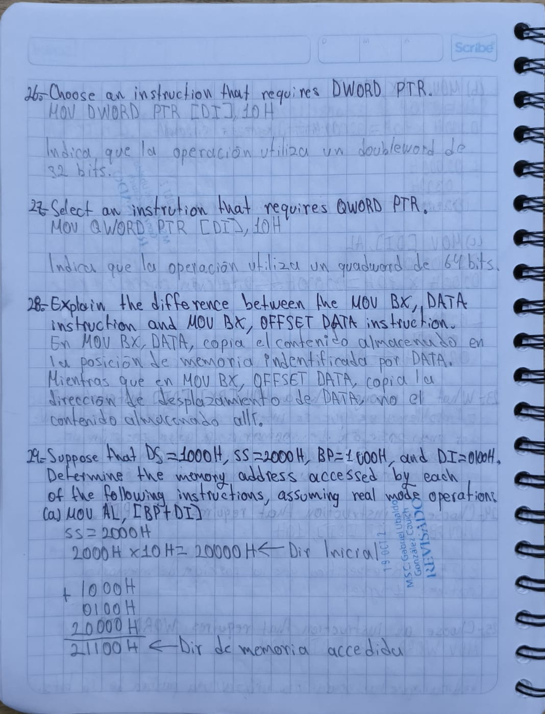

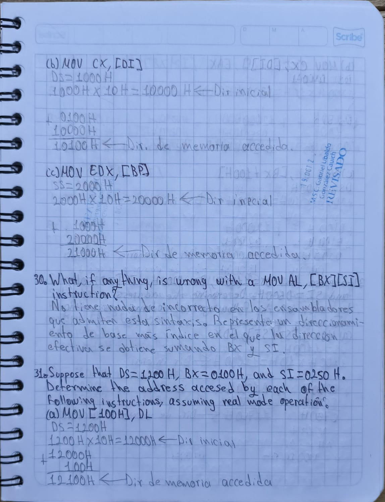

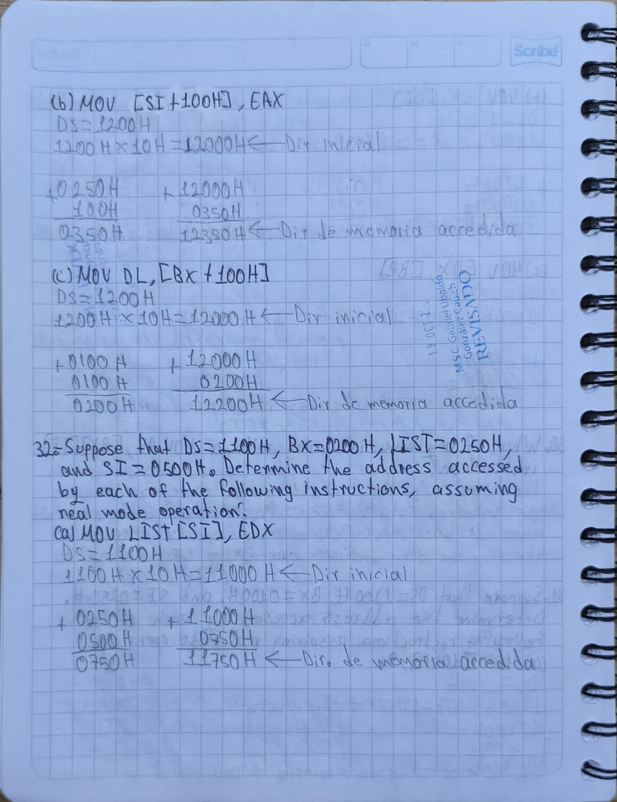

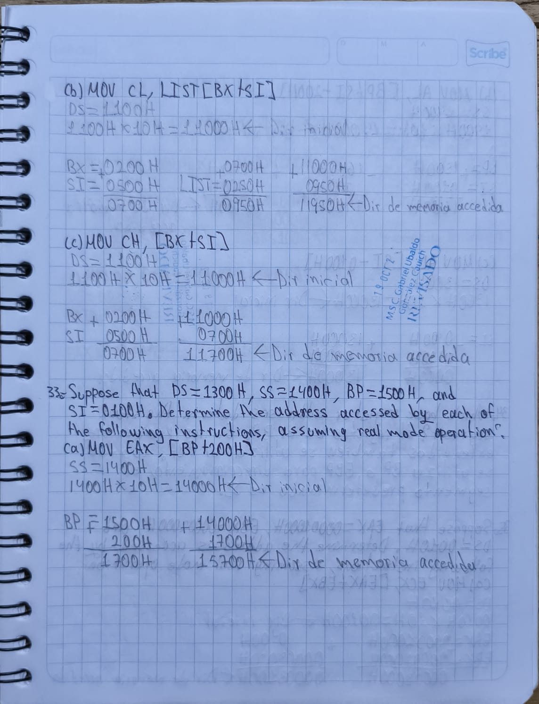

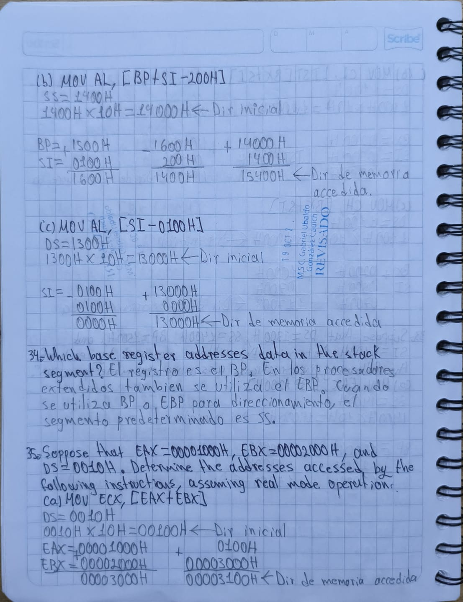

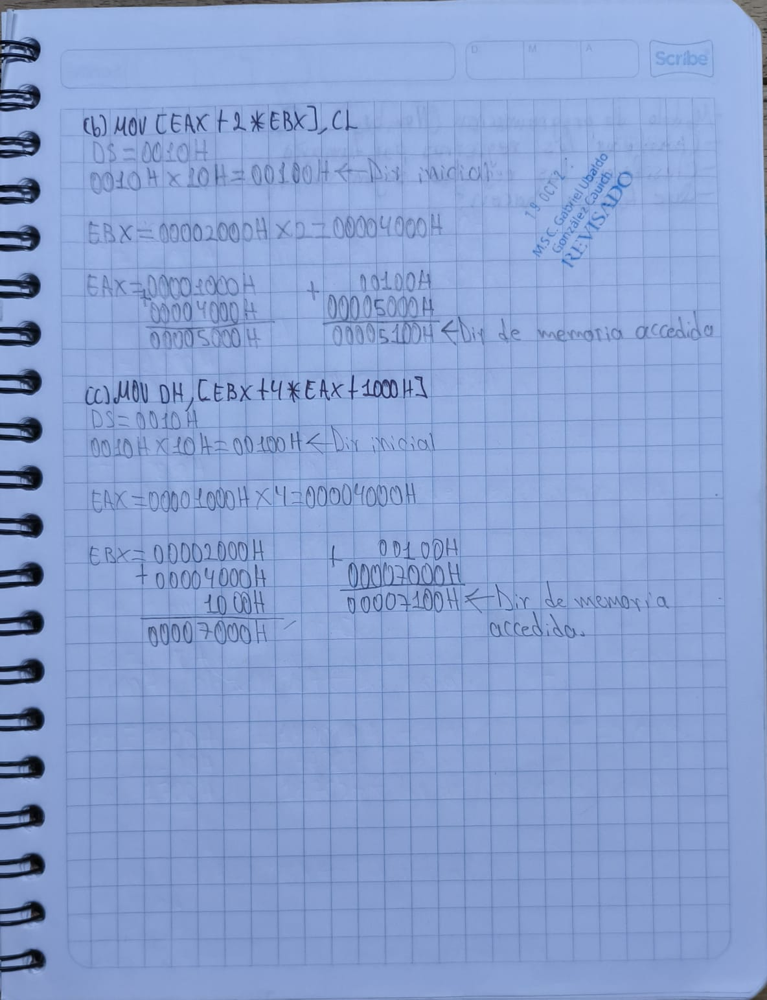

## ¿Qué aprendí?

«A través de este bloque de ejercicios, mejoré el uso del direccionamiento de datos al identificar con rapidez el origen y el destino de la información. Asimismo, reforcé el manejo de los registros y sus distintas capacidades, aprendí a detectar cuándo una operación es incorrecta y comprendí de mejor manera las características de este método. Por otra parte, mejore mi capacidad de realizar operaciones hexadecimales más complejas, lo que me permite calcular con correctamente la dirección inicial o final de memoria.

## Errores y aspectos por mejorar

Como principal aspecto a mejorar, está la realización de ejercicios hexadecimales más complejos, ya que al momento de realizarlos puedo cometer pequeños errores, lo que me llevaría a realizar una actividad de forma incorrecta. Otro posible aspecto que reconozco que debo mejorar es el reconocimiento de registros, ya que, a pesar de que ahora tengo un mejor conocimiento de ellos, podría ser mucho mejor al reconocerlos, así como su capacidad y la funcionalidad de todos.

---

# Reflexión general de la unidad 2

La unidad fue muy interesante al poder ampliar conocimientos previos y relacionarlos entre sí; de igual manera, pude conocer temas nuevos relacionados con el funcionamiento interno del microprocesador y el manejo de la memoria. Pude aprender sobre la arquitectura interna del microprocesador, los diferentes tipos de registros y la función que cumple cada uno, así como el registro de banderas y su importancia dentro del procesamiento de la información. De igual manera, pude comprender cómo se realiza el direccionamiento de memoria en modo real, además de conocer otros modelos como el modo protegido. En general, pienso que la unidad fue muy interesante y me será muy útil, ya que pude comprender mejor cómo funciona internamente un microprocesador y cómo se relaciona con la memoria, adquiriendo conocimientos que me servirán para comprender temas futuros de la asignatura.

---

# Conclusión unidad 2

En conclusión, considero que esta unidad ha estado llena de aprendizajes nuevos e importantes, como por ejemplo la arquitectura interna del microprocesador, los diferentes tipos de registros, el registro de banderas y las distintas formas de direccionamiento de memoria. De igual manera, me sirvió para comprender mejor cómo se relaciona el microprocesador con la memoria y cómo se manejan las direcciones de memoria mediante el modo real y el modo protegido. Considero que todos los aprendizajes adquiridos en la unidad me serán de gran utilidad en el ámbito profesional, ya que me permitirán comprender de mejor manera el funcionamiento interno de los equipos de cómputo y me servirán como base para abordar temas más avanzados en el futuro.
